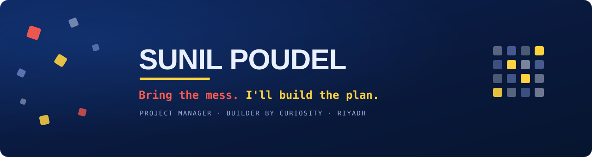

## `// whoami`

I run projects for a living and build software because I can't help it.

- 🏥 **Project Manager** at Abdal Human Resource, Riyadh — medical staffing & operations
- 🧩 I take messy briefs and turn them into **owned, dated plans** — people, process, delivery
- 🧠 Self-taught developer — Python, backend & computer vision, learning by shipping
- 🎯 Heading toward **AI / ML engineering**
- 🌍 Riyadh · 🇳🇵 Nepali · English · Hindi · Arabic · a little Korean

## `// the stack`

## `// the build`

| | Project | What it is |
|---|---|---|
| 🏥 | **[Abdal Medical Staffing](https://abdalnurse.sooneel.dev)** | Live nurse-availability portal on Notion data |
| 🧾 | **[CaseTracker](https://github.com/raizel078/CaseTracker)** | Desktop app to follow up cases & stats |
| 🛂 | **[Alice Travel Scanner](https://github.com/raizel078/Alicetravel)** | Passport scanning tool |
| 🚗 | **[Plate Detection](https://github.com/raizel078/NumberPlatedetection)** | Automatic number-plate recognition |
| 🧍 | **[Face Attendance](https://github.com/raizel078/Face-attandace-sheet)** | Attendance via face recognition |

## `// the numbers`

Bring the mess — I'll build the plan.

