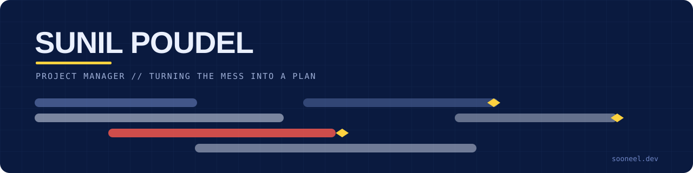
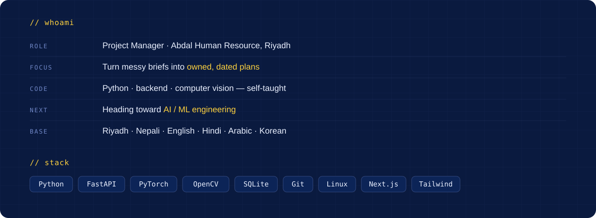

### `// the build`

&nbsp;&nbsp;🏥&nbsp; **[Abdal Medical Staffing](https://abdalnurse.sooneel.dev)** — live nurse-availability portal on Notion data
&nbsp;&nbsp;🧾&nbsp; **[CaseTracker](https://github.com/raizel078/CaseTracker)** — desktop app to follow up cases & stats
&nbsp;&nbsp;🛂&nbsp; **[Alice Travel Scanner](https://github.com/raizel078/Alicetravel)** — passport scanning tool
&nbsp;&nbsp;🚗&nbsp; **[Plate Detection](https://github.com/raizel078/NumberPlatedetection)** — automatic number-plate recognition
&nbsp;&nbsp;🧍&nbsp; **[Face Attendance](https://github.com/raizel078/Face-attandace-sheet)** — attendance via face recognition

### `// the numbers`

Bring the mess — I'll build the plan.

